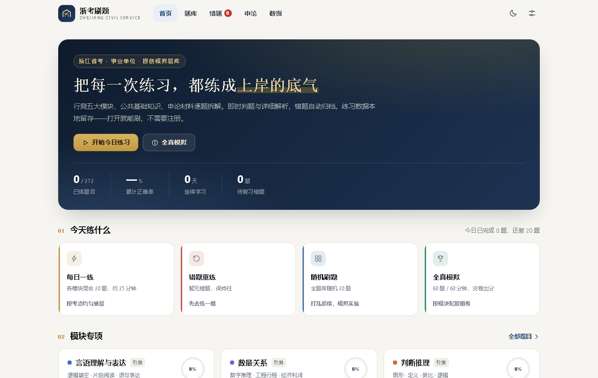
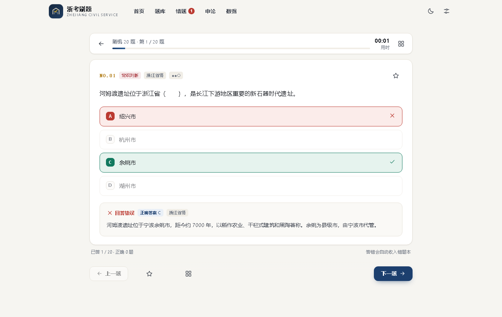
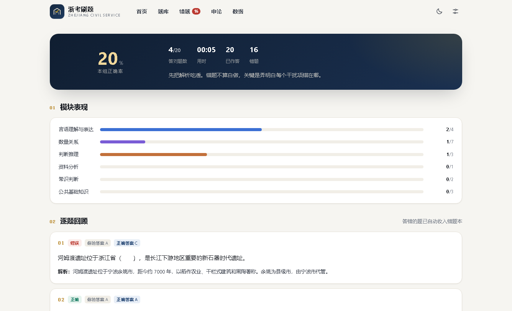
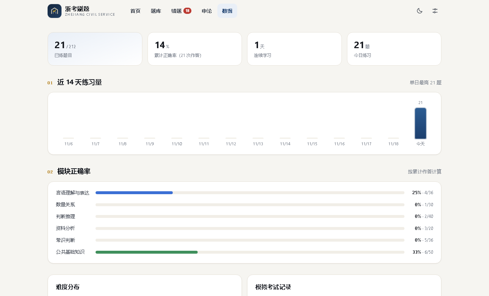
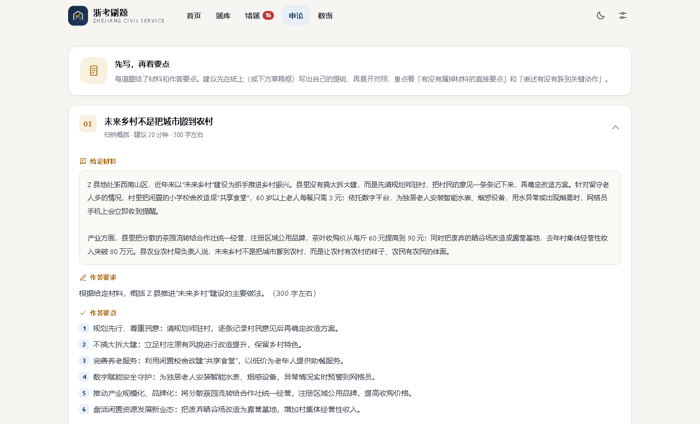

# 浙考刷题 · 浙江省公务员 / 事业单位 刷题页

一个纯前端、本地优先的刷题网页，面向浙江省公务员考试（行测）和事业单位公开招聘（公共基础知识、职业能力倾向测验）。打开就能练，不需要注册、不需要联网、不收集任何数据。



> 题库为**原创模拟题**，不是官方真题，不承诺押题命中。考试科目、题型、分值、时间以浙江省公务员局及各市县人力社保局当期公告、准考证为准。

## 在线使用（推荐）

**https://al1c0ach.github.io/zhejiang-civil-exam/**


手机浏览器直接打开即可，不需要电脑一直开着：

- Android Chrome / Edge：右上角菜单 → “安装应用”或“添加到主屏幕”
- iPhone Safari：分享 → “添加到主屏幕”

记录保存在手机浏览器本地（localStorage），换设备或清理浏览器数据前，先在「设置 → 导出记录」备份。

## 本地 / 离线使用

**方式一：直接打开（最简单）**

双击 `index.html`，用浏览器打开即可。题目、解析、样式、脚本都在本地。

**方式二：本地小服务（记录更稳）**

双击 `启动题库.bat`，会自动打开 <http://127.0.0.1:4173/>。手机和电脑连同一个 Wi-Fi 时，浏览器访问终端提示的局域网地址也能打开。

```bash
node scripts/serve.js 4173            # 默认监听 0.0.0.0，方便手机访问
node scripts/serve.js 4173 --host=127.0.0.1   # 只允许本机
```

**方式三：手机离线版**

把 `浙考刷题-手机版.html` 发到手机（微信/QQ 文件传输、网盘等），用手机浏览器打开。这是把样式、脚本、题库全部内联后的单文件，229 KB 左右，断网也能刷。

> 部分手机浏览器对 `file://` 本地文件的本地存储有限制，做题记录可能只在当前会话有效。需要长期保存记录时，优先用方式二，或定期在「设置 → 导出记录」备份。

## 界面预览

| 答题（即时判题） | 练习报告 |
| --- | --- |
|  |  |

| 学习数据 | 申论专区 |
| --- | --- |
|  |  |

## 题库内容

共 **212 道选择题 + 7 道申论材料题**，全部原创编写。

| 模块 | 题量 | 覆盖内容 |
| --- | --- | --- |
| 言语理解与表达 | 36 | 逻辑填空、片段阅读、语句表达、病句辨析 |
| 数量关系 | 30 | 数字推理、工程、行程、浓度、利润、容斥、年龄、植树、日期、时钟、排列组合 |
| 判断推理 | 40 | 图形推理（内联 SVG）、定义判断、类比推理、逻辑判断 |
| 资料分析 | 20 | 5 组材料：基期量、增长率、增长量、比重、倍数、顺差 |
| 常识判断 | 36 | 浙江省情、法律、政治、经济、科技、人文 |
| 公共基础知识 | 50 | 政治理论、法律、管理、公文、经济、科技人文、职业道德、省情 |
| 申论专区 | 7 | 归纳概括、综合分析、提出对策、应用文、大作文（材料 + 作答要点） |

难度按 1（基础）/ 2（进阶）/ 3（较难）标注；资料分析中的表格数据为**原创模拟数据**，已标注「仅用于练习」。

## 功能

- **模块专项**：按模块进入练习，可只练未做、只练错题、只练收藏，支持关键词搜索和难度筛选。
- **即时判题**：单选点击即判，多选（当前题库为单选）提交后判分，正确项、错选项与解析同时展示。
- **答题卡**：随时查看作答状态、跳题；练习中显示正确率与用时。
- **全真模拟**：按模块配额组卷 60 题 / 60 分钟，作答期间不显示对错，交卷统一出分并给出各模块表现；中途退出保留进度、计时继续，到时自动交卷。
- **错题本**：答错自动收录，连续答对 2 次自动移出，也可手动移出。
- **收藏夹**：星标重点题，考前集中回看。
- **学习数据**：完成度、累计正确率、连续学习天数、近 14 天练习量、模块正确率、难度分布、模拟成绩、最近作答。
- **申论专区**：材料 + 题目 + 作答要点，可展开对照；支持写「我的提纲」并自动保存在本机。
- **偏好设置**：浅色 / 深色 / 跟随系统、正文字号、答对自动下一题、每日目标题量、考试日期倒计时。
- **数据管理**：一键导出 / 导入 JSON 备份，一键清空记录。
- **手机适配**：底部导航、紧凑首页、触屏答题、答题卡弹层，无横向滚动。

## 快捷键

| 按键 | 作用 |
| --- | --- |
| `A` `B` `C` `D` 或 `1`—`4` | 选择选项 |
| `Enter` | 提交 / 下一题 |
| `←` `→` | 上一题 / 下一题 |
| `F` | 收藏本题 |
| `Esc` | 关闭弹层 |

## 目录结构

```text
index.html                  页面入口
启动题库.bat                Windows 一键启动本地服务
浙考刷题-手机版.html        单文件离线版（由脚本生成）
assets/
  styles.css                设计系统、深浅色主题、响应式
  app.js                    状态、存储、统计、路由与各页面
  practice.js               答题引擎：练习 / 模考 / 答题卡 / 报告
data/
  00-meta.js                模块定义、资料分析材料、免责声明
  01-yanyu.js               言语理解 22 题
  02-shuliang.js            数量关系 18 题
  03-panduan.js             判断推理 24 题（含 SVG 图形推理）
  04-ziliao.js              资料分析 12 题
  05-changshi.js            常识判断 20 题
  06-gongji.js              公共基础知识 26 题
  07-shenlun.js             申论材料题 5 道
scripts/
  validate.js               题库结构校验
  smoke.js                  无头浏览器冒烟测试（含截图）
  serve.js                  零依赖静态服务器
  build-standalone.js       打包单文件手机版
preview/                    界面截图
```

## 校验与打包

```bash
node scripts/validate.js --verbose     # 校验题量、选项、答案索引、重复题干，并逐题打印答案
node scripts/smoke.js                  # 用 Edge 无头模式跑完整流程、截图、捕获 JS 报错
node scripts/smoke.js 浙考刷题-手机版.html   # 校验单文件版
node scripts/build-standalone.js       # 修改题目或样式后，重新生成手机版
```

`smoke.js` 会检查首页、题库、答题、连答 20 题出报告、全真模拟交卷、图形推理、资料分析表格、学习数据、申论展开、设置页、手机布局、深色模式、刷新持久化，最后汇总 JS 报错。

## 怎么加题

题目就是普通的 JS 对象，按模块放在 `data/` 下。例如在 `01-yanyu.js` 的 `B.questions.push(...)` 里追加：

```js
{
  id: "yy-23",                 // 全局唯一，建议「模块前缀-序号」
  module: "yanyu",             // yanyu / shuliang / panduan / ziliao / changshi / gongji
  sub: "逻辑填空",              // 小节，会显示在题头
  diff: 2,                     // 1 基础 / 2 进阶 / 3 较难
  type: "single",              // single 单选；multi 多选（2—3 个正确项）
  material: null,              // 资料分析填材料 id，如 "m-industry"
  stem: "题干……",
  options: ["选项一", "选项二", "选项三", "选项四"],
  answer: [1],                 // 正确项下标，从 0 开始；多选写多个
  explain: "解析说明，指出正确依据和干扰项问题。",
  tags: ["实词辨析"]
}
```

图形推理使用 `figures` 字段，选项文字留空即可：

```js
{
  id: "pd-25",
  module: "panduan",
  sub: "图形推理",
  options: ["", "", "", ""],
  figures: {
    stem: ['<svg viewBox="0 0 100 100">…</svg>', /* 4 个 */],
    options: ['<svg …>', '<svg …>', '<svg …>', '<svg …>']
  },
  answer: [2]
}
```

新增资料分析材料时，在 `00-meta.js` 的 `materials` 里加一项（`title`、`note`、`html`），题目用 `material: "材料id"` 引用。改完运行 `node scripts/validate.js`，再 `node scripts/build-standalone.js` 重新打包手机版。

## 数据与隐私

所有做题记录、错题、收藏、申论提纲只保存在本机浏览器的 `localStorage`（键名 `zjks.v1.state`），不会上传到任何服务器。换设备或清理浏览器数据前，建议先在「设置 → 导出记录」保存一份 JSON。

## 免责声明

本页由 AI 辅助编写并经过结构与流程校验，题目、解析均为原创模拟内容，仅供备考练习，不构成官方考试资料。若与现行法律法规、官方教材或当期公告不一致，以官方文件为准。发现题目或解析有问题，直接修改 `data/` 下对应文件即可，刷新页面生效。
